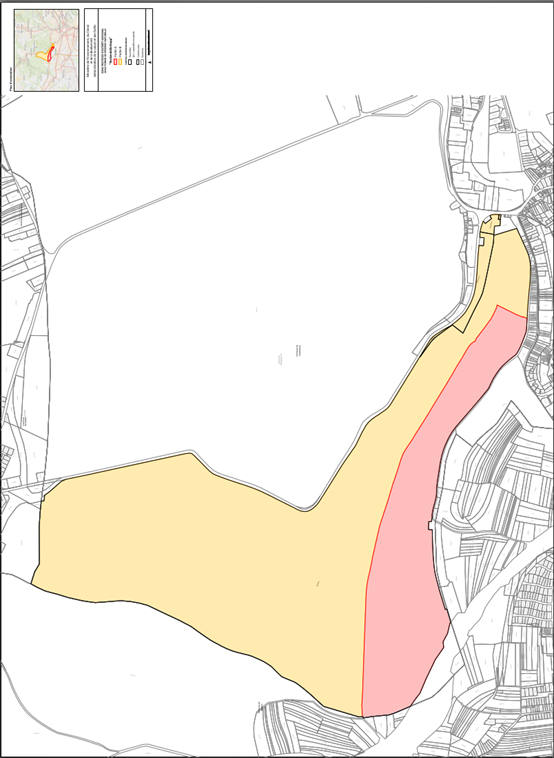

# Règlement grand-ducal du 22 juillet 2026 déclarant zone protégée d’intérêt national sous forme de réserve naturelle et de corridor écologique, la zone « Reckendallerkopp » sise sur le territoire de la Ville de Luxembourg.

Nous Guillaume, Grand-Duc de Luxembourg, Duc de Nassau,

Vu la [loi modifiée du 18 juillet 2018](https://legilux.public.lu/eli/etat/leg/loi/2018/07/18/a771/jo) concernant la protection de la nature et des ressources naturelles, et notamment ses articles 2, 15, 17, 34, 35 et 37 à 46 ;

Vu la [décision du Gouvernement en conseil du 20 janvier 2023](https://legilux.public.lu/eli/etat/leg/dgc/2023/01/20/a217/jo) relative au troisième plan national concernant la protection de la nature ;

Vu la fiche financière ;

Vu l’avis du Conseil supérieur pour la protection de la nature et des ressources naturelles ;

Vu l’accord du Gouvernement en conseil du 29 avril 2026 ;

Vu l’avis émis par le conseil communal de la Ville de Luxembourg après enquête publique ;

Les avis de la Chambre d’agriculture, de la Chambre des métiers, de la Chambre de commerce, de la Chambre des salariés et de la Chambre des fonctionnaires et employés publics ayant été demandés ;

Le Conseil d’État entendu ;

Sur le rapport du Ministre de l’Environnement, du Climat et de la Biodiversité et du Ministre des Finances, et après délibération du Gouvernement en conseil ;

Arrêtons :

## Art. 1er.

Est déclarée zone protégée d’intérêt national sous forme de réserve naturelle et de corridor écologique, la zone « Reckendallerkopp » sise sur le territoire de la Ville de Luxembourg, partie de la zone protégée d’intérêt communautaire « Vallée de la Mamer et de l’Eisch », référencée sous le code LU0001018.

## Art. 2.

La zone protégée d’intérêt national « Reckendallerkopp », d’une étendue totale de 218,90 hectares, se compose de deux parties :

1° la partie A, d’une étendue de 54,14 hectares, est formée par des fonds inscrits au cadastre de la Ville de Luxembourg, section RA de Rollingergrund ;

2° la partie B, d’une étendue de 164,80 hectares, est formée par des fonds inscrits au cadastre de la Ville de Luxembourg, section RA de Rollingergrund.

Sont également inclus tous les fonds et toutes les parcelles cadastrales ne portant pas de numéros se trouvant à l’intérieur du périmètre de la zone protégée d’intérêt national.

La délimitation de la zone protégée d’intérêt national, ainsi que des parties A et B, est indiquée sur les plans annexés.

## Art. 3.

Sont interdits dans l’intégralité de la zone protégée d’intérêt national, partie A et partie B :

1° les fouilles, les sondages, les travaux de terrassement, l’enlèvement de terre végétale, le déblai, le remblai ou l’extraction de matériaux ;

2° le dépôt de déchets ou de matériaux, à l’exception des grumes et du bois de chauffage sur les lieux d’entreposage ;

3° les travaux susceptibles de modifier le régime ou de dégrader la qualité des eaux superficielles ou souterraines, le drainage, le changement du lit des ruisseaux ou le curage, ainsi que le rejet d’eaux usées, la dégradation, la destruction ou la pollution des sources ;

4° toute construction incorporée au sol ou non. Cette interdiction ne s’applique pas :

a) à la mise en place de miradors ou d’installations légères d’affût de chasse ;

b) aux interventions nécessaires à l’entretien ou au renouvellement des constructions existantes ;

c) à l’élargissement ou au redressement de la voirie publique existante pour des raisons de sécurité ;

Les exceptions visées aux lettres b) et c) restent toutes soumises à autorisation préalable du ministre ayant l’Environnement dans ses attributions, ci-après « ministre » ;

5° la mise en place d’installations de transport et de communication, de conduites d’énergie, de liquide ou de gaz, de canalisations ou d’équipements assimilés, sauf dans les chemins consolidés existants. Les interventions nécessaires à l’entretien ou au renouvellement des installations existantes restent soumises à autorisation préalable du ministre. Les travaux d’entretien courants des installations existantes ne nécessitent pas l’autorisation préalable du ministre ;

6° le changement d’affectation des chemins communaux, ruraux ou forestiers, ou des pistes cyclables ;

7° le changement d’affectation des sols ;

8° la réduction, la destruction ou la détérioration de biotopes protégés et d’habitats visés par l’article 17 de la [loi modifiée du 18 juillet 2018](https://legilux.public.lu/eli/etat/leg/loi/2018/07/18/a771/jo) concernant la protection de la nature et des ressources naturelles ;

9° l’enlèvement, la destruction ou l’endommagement de plantes sauvages appartenant à la flore indigène ou de parties de ces plantes, sans préjudice de l’exploitation forestière ou des travaux nécessaires pour des raisons de sécurité ;

10° la perturbation, la capture ou la mise à mort d’animaux appartenant à la faune sauvage indigène, à l’exception de ceux considérés comme gibier, sans préjudice des dispositions afférentes de la législation sur la chasse ;

11° la divagation d’animaux domestiques ou le chien non tenu en laisse, à l’exception du chien courant dans l’exercice de la chasse ;

12° la circulation à l’aide d’automoteurs en dehors des voies munies d’un revêtement à base d’asphalte, de macadam, de bitume ou de béton. Cette interdiction ne s’applique pas aux propriétaires des terrains, ni à leurs ayants droit ;

13° la circulation surfacique avec des engins motorisés dans le contexte de l’exploitation forestière, à l’exception de la circulation des engins sylvicoles sur les chemins existants ou sur des layons de débardage distancés les uns des autres de 40 mètres au minimum ;

14° la transformation de peuplements indigènes en peuplements allochtones ;

15° la plantation d’essences allochtones dans les forêts publiques ;

16° l’emploi de pesticides, la fertilisation ou le chaulage.

## Art. 4.

Est en outre interdite dans la seule partie A de la zone protégée, l’exploitation forestière des forêts à l’exception des travaux nécessaires pour des raisons de sécurité le long de la voirie publique, des chemins et des sentiers, les arbres ainsi abattus étant à abandonner sur place.

## Art. 5.

Les dispositions énumérées aux articles 3 et 4 ne s’appliquent pas aux mesures, interventions et activités prises :

1° dans l’intérêt de la conservation, du suivi scientifique et de la gestion de la zone protégée d’intérêt national ;

2° dans l’intérêt de la promotion pédagogique et de la sensibilisation environnementale ;

3° dans l’intérêt de la recherche scientifique, de la conservation et de la restauration du patrimoine historique et culturel dans la zone protégée d’intérêt national ;

4° dans le cadre de la réalisation de sondages et de nouveaux captages d’eau potable destinée à la consommation humaine ;

5° dans le cadre de la réalisation des installations nécessaires à la distribution d’eau destinée à la consommation humaine ;

6° dans l’intérêt de sauvegarder la sécurité d’approvisionnement du pays et des clients raccordés aux réseaux d’énergie, et dans le cadre de l’installation de nouvelles lignes à haute tension jusqu’à 400 kilovolts, ainsi que toutes les lignes et installations connexes ;

7° dans le cadre de la réalisation du réseau cyclable national conformément à la [loi modifiée du 28 avril 2015](https://legilux.public.lu/eli/etat/leg/loi/2015/04/28/n1/jo) relative au réseau cyclable national.

Toutes ces mesures, interventions et activités restent toutefois soumises à autorisation préalable du ministre.

## Art. 6.

Le ministre ayant l’Environnement dans ses attributions et le ministre ayant les Finances dans ses attributions sont chargés, chacun en ce qui le concerne, de l’exécution du présent règlement qui sera publié au Journal officiel du Grand-Duché de Luxembourg.

Le Ministre de l’Environnement,  du Climat et de la Biodiversité,   Serge Wilmes   Le Ministre des Finances,   Gilles Roth

Fait le 22 juillet 2026.   Guillaume

\**Annexe**

*[image omitted (0.7 MB) — see the official version: https://legilux.public.lu/eli/etat/leg/rgd/2026/07/22/a410/jo]*

Pour visualiser les cartes en haute résolution, [veuillez cliquer ici](http://data.legilux.public.lu/filestore/eli/etat/leg/rgd/2026/07/22/a410/jo/fr/pdfa/annexe/1/eli-etat-leg-rgd-2026-07-22-a410-jo-fr-pdfa-annexe-1.pdf).
