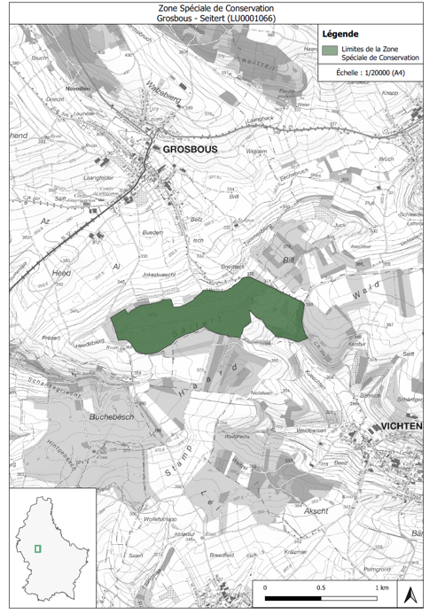

# Règlement grand-ducal du 17 août 2026 modifiant le règlement grand-ducal du 15 juillet 2022 désignant zone spéciale de conservation la zone « Grosbous - Seitert ».

Nous Guillaume, Grand-Duc de Luxembourg, Duc de Nassau,

Vu les articles 2, 4, 31 à 35 et 37, de la [loi modifiée du 18 juillet 2018](https://legilux.public.lu/eli/etat/leg/loi/2018/07/18/a771/jo) concernant la protection de la nature et des ressources naturelles ;

Vu l’avis de l’Observatoire de l’Environnement naturel ;

Vu l’avis de la Chambre de commerce ;

Les avis de la Chambre des métiers et de la Chambre d’agriculture ayant été demandés ;

Le Conseil d’État entendu ;

Sur le rapport du Ministre de l’Environnement, du Climat et de la Biodiversité, et après délibération du Gouvernement en conseil ;

Arrêtons :

## Art. 1er.

L’article 3 du [règlement grand-ducal du 15 juillet 2022](https://legilux.public.lu/eli/etat/leg/rgd/2022/07/15/a420/jo) désignant zone spéciale de conservation la zone « Grosbous – Seitert » est modifié comme suit :

1° Au point 1°, les mots maintien, voire sont insérés avant les mots rétablissement de l’état de conservation ;

2° Le point 3° est modifié comme suit :

a) À la lettre c), les mots aménagement de lisières structurées et d’îlots de vieillissement ; sont supprimés ;

b) À la suite de la lettre c), il est inséré une lettre d) nouvelle, libellée comme suit :

> « d)  aménagement de lisières structurées et d’îlots de vieillissement ; » ;

3° Le point 4° est modifié comme suit :

a) À la lettre a), les mots aménagement de lisières structurées et d’îlots de vieillissement ; sont supprimés ;

b) À la suite de la lettre a), il est inséré une lettre a*bis*) nouvelle, libellée comme suit :

> austom aménagement de lisières structurées et d’îlots de vieillissement ; » ;
>
> « a*bis)*

4° Le point 5° est modifié comme suit :

a) La phrase liminaire est complétée par les mots et des chênaies pédonculées ou des chênaies-charmaies sub-atlantiques et médio-européennes du  *Carpinion  betuli* (9160) ;

b) À la suite de la lettre a), il est inséré une lettre a*bis*) nouvelle, libellée comme suit :

> austom « a*bis)* préservation et restauration des micro-stations ; » ;

c) À la lettre c), le point final est remplacé par un point-virgule ;

d) À la suite de la lettre c), il est inséré une lettre d) nouvelle, libellée comme suit :

> « d) aménagement d’îlots de vieillissement ; » ;

5° À la suite du point 5°, il est inséré un point 6° nouveau, libellé comme suit :

> « 6°  maintien, voire rétablissement de l’état de conservation favorable de la population du Dicrane vert *Dicranum viride* :
>
> a) préservation et restauration des futaies feuillues ;
>
> b) préservation de gros arbres, d’arbres de classes d’âge avancées, d’arbres biotopes et d’arbres morts ;
>
> c) aménagement d’îlots de vieillissement. ».

## Art. 2.

À l’article 5, deuxième phrase, du [même règlement](https://legilux.public.lu/eli/etat/leg/rgd/2022/07/15/a420/jo), les mots 21,61 hectares sont remplacés par les mots 61,84 hectares .

## Art. 3.

L’annexe du [même règlement](https://legilux.public.lu/eli/etat/leg/rgd/2022/07/15/a420/jo) est remplacée par l’annexe du présent règlement.

## Art. 4.

Le ministre ayant l’Environnement dans ses attributions est chargé de l’exécution du présent règlement qui sera publié au Journal officiel du Grand-Duché de Luxembourg.

Le Ministre de l’Environnement,  du Climat et de la Biodiversité,   Serge Wilmes

Fait le 17 août 2026.   Guillaume

\**Annexe**

Pour visualiser l’annexe en haute résolution, [veuillez cliquer ici](http://data.legilux.public.lu/filestore/eli/etat/leg/rgd/2026/08/17/a479/jo/fr/pdfa/annexe/1/eli-etat-leg-rgd-2026-08-17-a479-jo-fr-pdfa-annexe-1.pdf).
